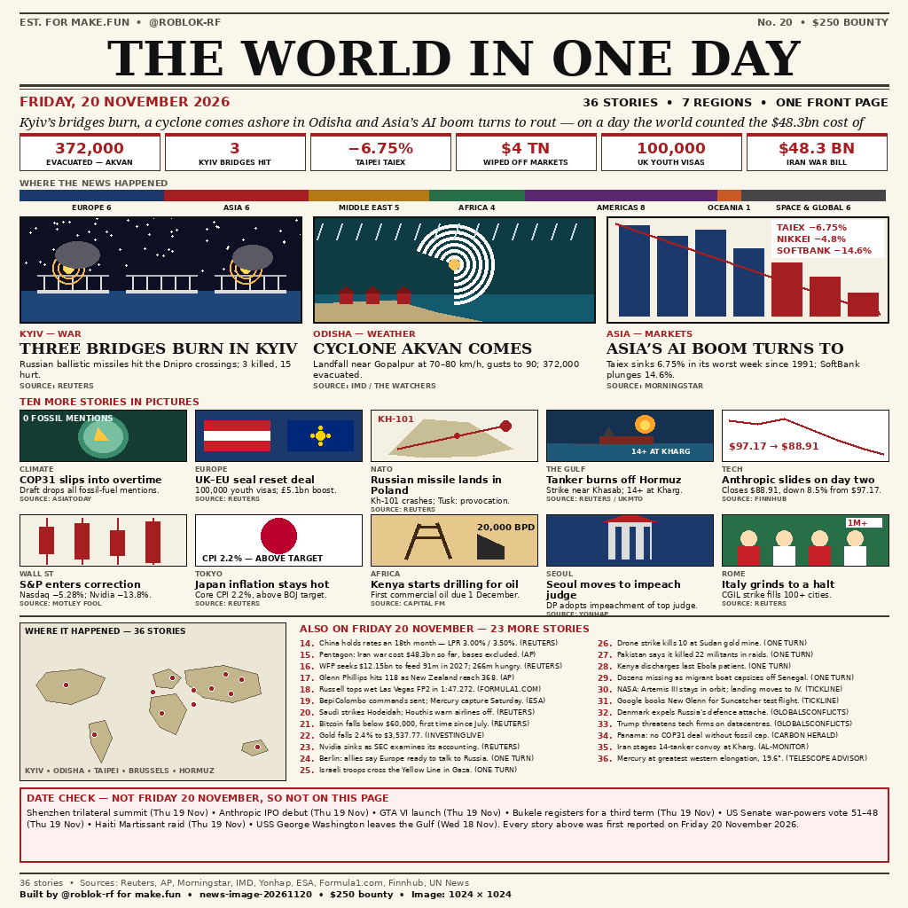

[](https://make.fun/bounty/news-image-20261120)
[](https://make.fun/bounty/news-image-20261120)
[](https://make.fun/bounty/news-image-20261120)

# The World in One Day — Friday 20 November 2026

**Bounty:** [Sum up 20 November's world news in one image](https://make.fun/bounty/news-image-20261120) ($250, 50 places, closes Sunday 22 November 2026, 07:00 +07)
**Account:** [@roblok-rf](https://make.fun/u/roblok-rf) — GitHub [roblok-rf](https://github.com/roblok-rf), Solana wallet `GamuCiC7m8fYyBzd9C4gSppT1FVhK9ijfiapX1dGg48w`
**Referral:** [make.fun/r/qj9bnys8](https://make.fun/r/qj9bnys8)



One dense illustrated newspaper front page: **36 stories**, every one first reported on **Friday 20 November 2026**. Three large illustrated leads — Russian missiles hit three Kyiv bridges, Cyclone Akvan comes ashore in Odisha, Asia's AI sell-off — plus ten smaller illustrated stories, a world map, a six-figure stat strip, a colour-coded per-region story bar, and a red **DATE CHECK** box that names the big 19 November stories deliberately left out.

## The 36 stories

### Three leads
1. **Three bridges burn in Kyiv** — Russian ballistic missiles hit the Podilsko-Voskresenskyi, Darnytskyi and Pivdennyi bridges; 3 killed, 15 hurt, in the biggest bridge attack of the war. *Reuters*
2. **Cyclone Akvan comes ashore** — Landfall near Gopalpur, Odisha at 70–80 km/h with gusts to 90; 372,000 people moved to shelters; no deaths in the first count. *IMD / The Watchers*
3. **Asia's AI boom turns to rout** — Taiwan's Taiex sinks 6.75% in its worst week since 1991; Nikkei −4.8%; SoftBank plunges 14.6%. *Morningstar*

### Ten more stories in pictures
4. **COP31 slips into overtime** — Draft drops every fossil-fuel mention; Panama vows to block it. *AsiaToday*
5. **UK–EU seal reset deal** — 100,000 youth visas a year; food trade eased; £5.1bn boost. *Reuters*
6. **Russian missile lands in Poland** — Kh-101 crashes near Nowy Lipowiec; Tusk calls it a provocation. *Reuters*
7. **Tanker burns off Hormuz** — Projectile strike near Khasab; 14+ tankers mass at Kharg Island. *Reuters / UKMTO*
8. **Anthropic slides on day two** — Shares close $88.91, down 8.5% from $97.17 after the record IPO. *Finnhub*
9. **S&P enters correction** — Nasdaq −5.28%; Nvidia −13.8% as the SEC eyes its accounting. *Motley Fool*
10. **Japan inflation stays hot** — Core CPI 2.2% in October, a second month above the BOJ target. *Reuters*
11. **Kenya starts drilling for oil** — Turkana spudding begins; first commercial oil due 1 December. *Capital FM*
12. **Seoul moves to impeach top judge** — Ruling party adopts impeachment of Chief Justice Jo Hee-de. *Yonhap*
13. **Italy grinds to a halt** — CGIL general strike fills 100+ cities; 1m march, unions claim. *Reuters*

### Also on Friday 20 November — 23 more
14. China holds lending rates for an 18th month — LPR 3.00% / 3.50%. *Reuters*
15. Pentagon: Iran war has cost $48.3bn so far, bases excluded. *AP*
16. WFP seeks $12.15bn to feed 91m people in 2027; 266m go hungry. *Reuters*
17. Glenn Phillips hits 118 as New Zealand reach 368 in Wellington. *AP*
18. Russell tops a wet Las Vegas FP2 in 1:47.272 for Mercedes. *Formula1.com*
19. BepiColombo commands sent; Mercury capture set for Saturday. *ESA*
20. Saudi coalition strikes Hodeidah port; Houthis warn airlines off. *Reuters*
21. Bitcoin falls below $60,000 for the first time since July. *Reuters*
22. Gold tumbles 2.4% to $3,537.77 in its worst week since March. *InvestingLive*
23. Nvidia sinks as the SEC examines its accounting practices. *Reuters*
24. Berlin: allies say Europe is ready to talk with Russia. *One Turn*
25. Israeli troops cross the Yellow Line in central Gaza. *One Turn*
26. Drone strike kills 10 at a gold mine in Sudan's South Kordofan. *One Turn*
27. Pakistan says it killed 22 militants in northwest raids. *One Turn*
28. Kenya discharges its last Ebola patient, 37 days after case one. *One Turn*
29. Dozens missing after a migrant boat capsizes off Senegal. *One Turn*
30. NASA: Artemis III stays in orbit; first landing moves to Artemis IV. *Tickline*
31. Google books Blue Origin's New Glenn for its Suncatcher test flight. *Tickline*
32. Denmark expels Russia's defence attaché over an alleged plot. *GlobalsConflicts*
33. Trump threatens penalties on tech firms building data centres abroad. *GlobalsConflicts*
34. Panama vows to block any COP31 deal with no fossil-fuel cap. *Carbon Herald*
35. Iran stages a 14-tanker convoy at Kharg to test the US blockade. *Al-Monitor*
36. Mercury reaches greatest western elongation, 19.6° from the Sun. *Telescope Advisor*

## Date discipline

Every story above was first reported on Friday 20 November 2026. These big stories were **deliberately excluded** because they happened on Thursday 19 November: the Shenzhen trilateral summit, the Anthropic IPO debut, the GTA VI launch, Bukele registering for a third term, the US Senate war-powers vote (51–48), the Haiti Martissant raid, and the USS George Washington leaving the Gulf (18 November). The front page carries a red DATE CHECK box naming them, so the date boundary is explicit.

## How it was built (ATM)

Before drawing anything, the top 10 entries in this bounty were studied live on 21 November 2026 (12,492 entries total). See [MODELS.md](MODELS.md) for the full study and the 15 ATM models — model 11, the Combined Best, is this image. The winning formula all ten share: one extremely dense illustrated newspaper front page (not a photo collage), a small red masthead, a giant serif date, an italic subhead, a stat strip, a per-region story bar, three large illustrated lead panels, ten smaller illustrated stories, a numbered brief list, a named source beside every story, and a strict date check. This entry follows that formula and adds the strictest date discipline of the ten: seven near-miss 19 November stories are named and excluded in print.

## Files

| File | What it is |
| --- | --- |
| `entry.png` | The front page — 1024×1024 PNG, under 1 MiB |
| `render.py` | Deterministic Pillow renderer that draws `entry.png` |
| `main.py` | Entry program (stdlib only, no network): copies `entry.png` to the output directory and prints its SHA-256 |
| `README.md` | This file |
| `MODELS.md` | The ATM study: top 10 entries and 15 models |
| `TRANSCRIPT.md` | Step-by-step record of how this entry was built |
| `LICENSE` | MIT license |

## Run it

```sh
python3 render.py   # draws entry.png (1024x1024)
python3 main.py     # copies entry.png to /output/ (or ./output/) and prints its SHA-256
```

Run `main.py` twice and compare the printed hashes: both runs must print the same
SHA-256, proving the output is deterministic byte-for-byte.

Requires Python 3.12 and Pillow 10.2 (DejaVu fonts from the system). No network access is needed at render time; all news was verified by live search before the build.

## Submission note

**NOT submitted yet.** Submission to make.fun needs the owner's wallet signature and a valid transcript bundle produced by the make.fun CLI from the real agent session that built this entry. Do **not** upload loose `TRANSCRIPT.md` or `makefun-run.json` files — only the CLI bundle counts as a run record.
